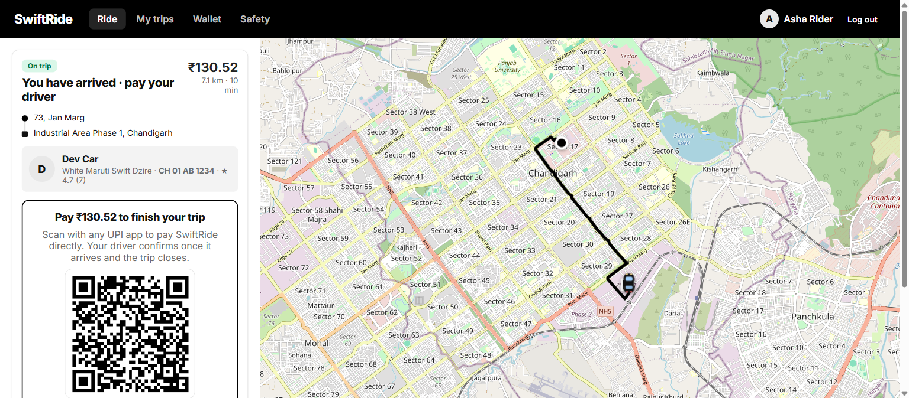
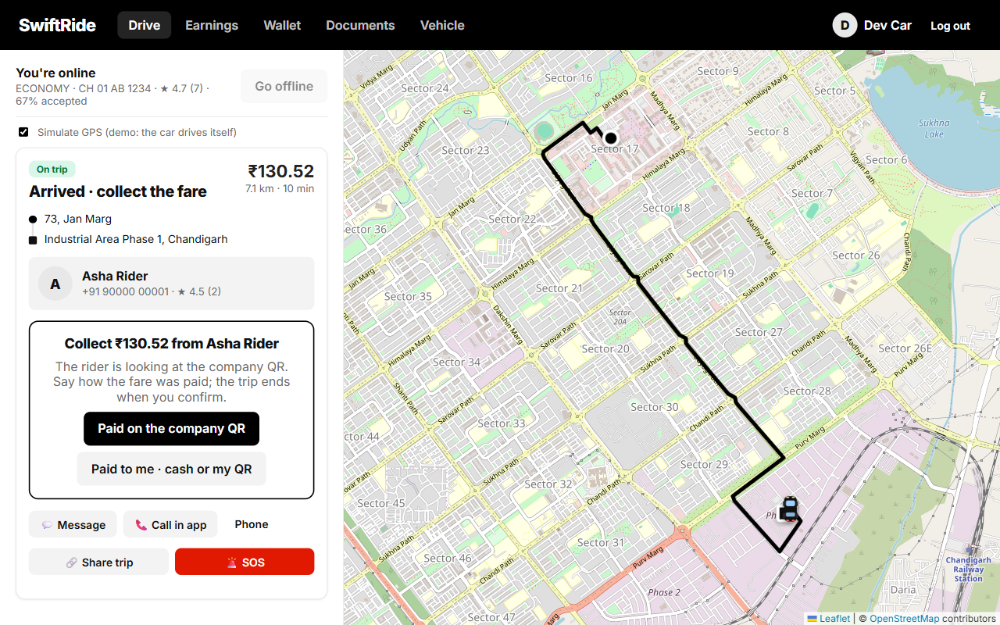
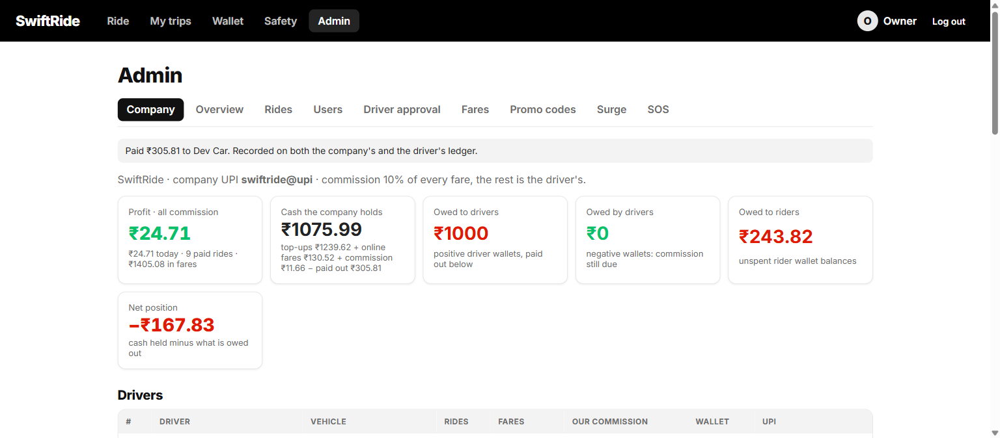
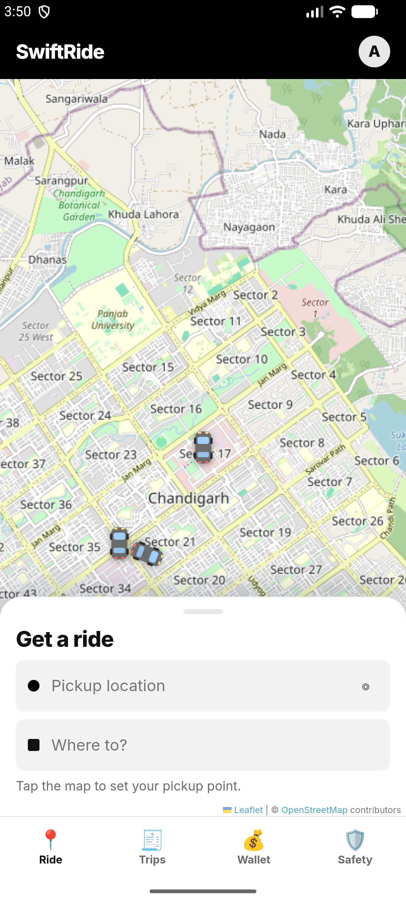
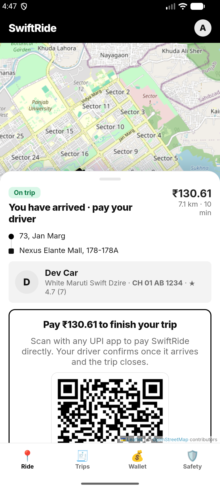
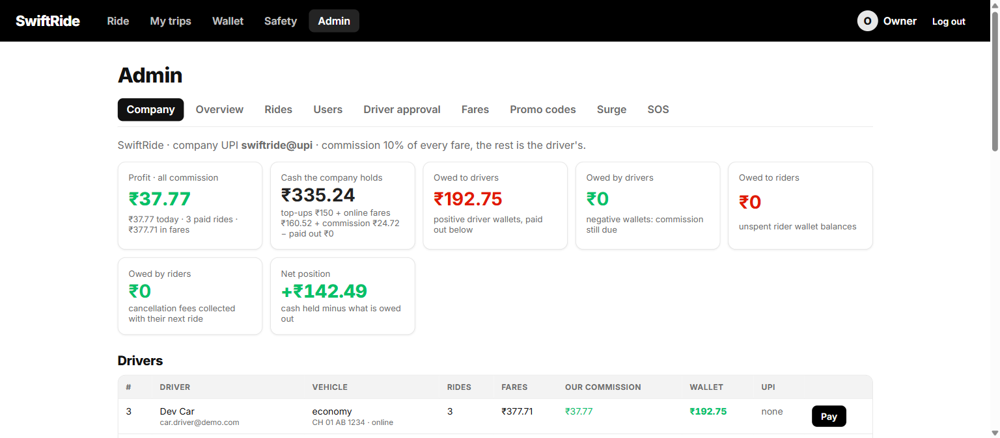
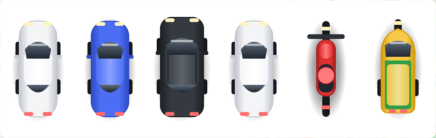

# SwiftRide — Test Report with Screenshots

Date: 21 October 2026
Server: `C:\Projects\Ideas\Uber`, port 4000, demo in the Chandigarh tricity (Chandigarh, Mohali, Zirakpur, Panchkula)
Commission: 10% of every fare to the company, 90% to the driver

Every screenshot below was taken from the running app during the tests described. Phone screenshots come from the signed APK running on the Android emulator (Pixel-class, Android 16).

---

## 1. Accounts used for testing

| Account | Password | What it is | Used for |
| --- | --- | --- | --- |
| `rider@demo.com` | `password` | Rider (Asha) | Every rider-side test, browser and phone |
| `rider2@demo.com` | `password` | Rider (Rahul) | Second rider over the API for class and wallet checks |
| `car.driver@demo.com` | `password` | Car driver · Go · Maruti Swift Dzire · CH 01 AB 1234 | Most driver-side tests |
| `car2.driver@demo.com` | `password` | Car driver · Go · Hyundai Aura | Dispatch radius checks (Zirakpur) |
| `moto.driver@demo.com` | `password` | Moto driver · Honda Activa | Moto class tests |
| `auto.driver@demo.com` | `password` | Auto driver · Bajaj RE (three-wheeler) | Auto class tests |
| `comfort.driver@demo.com` | `password` | Comfort driver · Honda City | Comfort class tests (Mohali) |
| `suv.driver@demo.com` | `password` | SUV driver · XL · Toyota Innova | XL class tests (Panchkula) |
| `owner@demo.com` | `password` | **Owner**: company books, every account, payouts | Company tab tests |
| `admin@demo.com` | `password` | Admin: rides, users, fares, promos, SOS | Admin panel tests |

Each driver account has one registered vehicle (make, model, colour, plate) and can only receive rides priced for that vehicle class. Demo drivers start with ₹200 in the wallet so cash rides can be offered to them.

---

## 2. Rider and driver side by side (two browser sessions)

Rider on `http://localhost:4000`, driver on `http://127.0.0.1:4000`, both live over Socket.IO.

| Step | Result |
| --- | --- |
| Rider books Sector 17 → Elante Mall, Go, cash | Route 7.1 km, ₹130.52 |
| Driver tab | Offer appears with countdown, rider's rating shown ("Asha Rider ★ 4.5") |
| Driver accepts | Rider tab: "Dev Car is 1 min away", PIN shown |
| Chat | Rider's message raised "💬 Message (1)" on the driver tab before opening; reply seen by the rider |
| In-app call | Rider calls, driver answers, "On call 00:04", hang up; both chats show "📞 Voice call · 00:04" (Outgoing / Incoming) |
| Cancel dialog | Rider: 8 reasons + "Other reason" text box, fee note; driver: 8 driver reasons + ₹20 penalty note. Both ask for confirmation |
| "I've arrived" | Only allowed within 1 km of the pickup (server-checked; hint shows the distance) |
| PIN | Wrong PIN refused; right PIN starts the trip |
| Car on the map | Glides between position updates and turns smoothly (8 distinct positions sampled in 1.2 s) |
| End of a cash ride | Driver taps "Reached the destination · collect ₹130.52". Rider sees **Pay ₹130.52** with the company UPI QR; driver sees **Collect ₹130.52** with "Paid on the company QR" / "Paid to me". The trip is **not** over until the driver confirms |
| Company QR | Company holds ₹130.52, driver credited ₹117.47 (90%), profit ₹13.05 |
| Paid to driver | Driver keeps the fare, ₹11.66 commission debited from his wallet, company books ₹11.66 |
| Receipt | "Paid by company QR (UPI)" or "cash or the driver's QR" |
| Ratings | Rider and driver rate each other; both ratings are true averages of every rating received ("★ 4.7 (7)") |

Screenshots: `test-2026-10-21-tricity-booking.png`, `test-2026-10-21-two-tabs-offer.png`, `test-2026-10-21-two-tabs-rider-chat.png`, `test-2026-10-21-two-tabs-driver-chat.png`, `test-2026-10-21-call-rider.png`, `test-2026-10-21-call-driver.png`, `test-2026-10-21-call-log.png`, `test-2026-10-21-cancel-dialog.png`, `test-2026-10-21-driver-cancel-dialog.png`, `test-2026-10-21-car-on-trip.png`, `test-2026-10-21-pay-rider-qr.png`, `test-2026-10-21-collect-driver.png`, `test-2026-10-21-collect-confirm.png`.

---

## 3. One ride per vehicle class, across the tricity (API)

All five drivers online at their home spots. One ride requested per class; every driver's offer list checked.

| Ride | Pickup → drop | Fare | Offered to | Everyone else |
| --- | --- | --- | --- | --- |
| Moto | Sector 35 → Sector 17 | ₹39.72 | moto.driver only | nothing |
| Auto | ISBT Sector 43 → Sector 17 | ₹82.35 | auto.driver only | nothing |
| Go | Zirakpur Chowk → Elante | ₹143.76 | car2.driver (Zirakpur) | nothing |
| Comfort | Phase 3B2 Mohali → Chandigarh Airport | ₹272.96 | comfort.driver only | nothing |
| XL | Sector 5 Panchkula → Zirakpur | ₹342.04 | suv.driver only | nothing |

A wrong-class accept is refused with a plain message, for example "This is a Moto ride. Your registered vehicle is in the Go class, so it is not for you." Browser runs of the Moto and XL rides: `test-2026-10-21-moto-booking.png`, `test-2026-10-21-moto-offer.png`, `test-2026-10-21-xl-booking.png`, `test-2026-10-21-xl-offer.png`.

**Commission guarantee:** with the auto driver's wallet at ₹0, an Auto cash ride was not offered to him at all, and a direct accept says how much he needs ("Cash rides need at least ₹8.24 in your wallet…"). With the wallet restored, the ride was offered again.

---

## 4. Money

| Check | Result |
| --- | --- |
| Earnings page | "Today / all time · your earnings", rating, "Earnings the company owes you" with **Request payout**, "Fines and dues to pay" with **Pay now** |
| Breakdown | Fares paid by riders − 10% platform commission = your share, split into cash kept in hand and wallet credits; late-cancellation fees and penalties listed |
| Dues | After a cash ride on an empty wallet the driver owed ₹9.62; "Pay ₹9.62 now" opened the wallet pre-filled; the top-up cleared it |
| Payout | Driver requests; the owner pays from the Company tab; both ledgers record it |
| Owner's Company tab | Profit (all commission), cash the company holds, owed to drivers, owed by drivers, owed to riders, net position; every driver with fares, commission, wallet, UPI and a **Pay** button; every rider and staff account; the company ledger |
| Owner pays Dev Car | "Paid ₹305.81 to Dev Car. Recorded on both the company's and the driver's ledger." |

Screenshots: `test-2026-10-21-earnings.png`, `test-2026-10-21-earnings-withdrawn.png`, `test-2026-10-21-earnings-dues.png`, `test-2026-10-21-wallet-dues.png`, `test-2026-10-21-owner-company.png`.

---

## 5. Phone: the signed APK on an Android emulator

`dist-apk/SwiftRide-release.apk`, server address `http://192.168.1.9:4000` baked in.

| Check | Result |
| --- | --- |
| Install and launch | Landing page renders (`test-2026-10-21-android-login.png`) |
| Stale server address | The app found the old saved address dead and switched to the baked one by itself, with a note (`test-2026-10-21-android-login-fixed.png`) |
| Login | Demo accounts panel loads from the server; rider logs in |
| Ride screen | Chandigarh map with the demo cars on it (`test-2026-10-21-android-ride.png`) |
| Use my location | First attempt timed out on the emulator's GPS; the message now says "No GPS fix yet" instead of "permission denied", and with a 15-second wait the pickup resolved to "73, Jan Marg" (Sector 17) |
| Search | "elante" lists Elante Mall under well-known places (`test-2026-10-21-android-search.png`) |
| Trips | Totals, rating card and history render on the phone (`test-2026-10-21-android-trips.png`) |
| Layout bug found and fixed | With the keyboard open the suggestion list sat under the keyboard and tab bar; the sheet now grows, the tab bar hides and the field scrolls to the top while typing (`test-2026-10-21-android-search.png`) |
| Quote | Two routes (A ₹130.61, B ₹136.60) and all five classes, Moto to XL, with the new Auto icon (`test-2026-10-21-android-quote.png`, `test-2026-10-21-android-classes.png`) |
| Full ride, phone rider + browser driver | Confirmed on the phone; the car driver's tab got the offer and accepted; the phone switched live to "Dev Car is heading to you" with PIN 5367 (`test-2026-10-21-android-driver-coming.png`) |
| End of the ride on the phone | Driver reached the destination; the phone showed **Pay ₹130.61** with the company QR (`test-2026-10-21-android-pay-qr.png`); the driver confirmed "Paid on the company QR"; the phone showed the receipt, "Paid by company QR (UPI)" (`test-2026-10-21-android-receipt.png`) |
| Commission rule seen in practice | After the owner paid the car driver out, his wallet was ₹0 and the first phone booking found no driver (he could not cover the 10%); the driver screen now warns about an empty wallet, and after a top-up the next booking reached him |

---

## 6. Automated tests

`npm test`: 41 tests, all passing. They cover fares, wallets, promos, dispatch, the ride lifecycle, PIN, cancellation fees, the arrival radius, vehicle-class matching, true-average ratings, call entries in chat, the two-step cash ending with company-QR and driver-collected settlement, the commission precondition, owner payouts, wallet-first payment with a remainder, fines carried to the next ride, and the demo reset.

---

## 7. Rider wallet, fines, and the clean books

All old rides and transactions were wiped (owner's **Reset all rides and transactions** button, also `node scripts/reset-demo.mjs`), the two throwaway signup accounts from an API test were removed, and every entry below was then made through the apps.

**The rules**

- The rider's wallet is use-only: it pays rides automatically when they end, covers as much of the amount as it holds, never goes negative, and cannot be withdrawn.
- "Pay with Wallet" at booking shows what the wallet will cover and what is left for cash or UPI at the end.
- A late-cancellation fee comes out of the wallet as far as it goes; the rest is carried to the rider's next ride, shown at booking ("Includes ₹30 cancellation fee…") and on the pay screen. The driver who was cancelled on gets the whole fee at once.
- A driver only receives a ride on which cash could change hands if his wallet already covers the commission; a rider whose wallet covers the whole amount can be served by any driver.

**What was done, in order**

| # | Action (through the app) | Books afterwards |
| --- | --- | --- |
| 1 | Rider adds ₹50 in Wallet; driver (Dev Car) adds ₹100 | Company holds ₹150 (money held for users) |
| 2 | Ride 1, Sector 17 → Elante, ₹130.52, "Pay with Wallet": wallet pays ₹50 automatically, rider's screen shows **Pay ₹80.52**, driver confirms "Paid on the company QR" | Online fares +₹130.52 (₹50 wallet + ₹80.52 QR); driver credited ₹117.47; profit ₹13.05 |
| 3 | Ride 2: driver arrives, rider cancels late (₹30 fee) with the wallet empty | Driver credited ₹30; rider now owes ₹30, carried forward |
| 4 | Ride 3, "Pay with Wallet" on an empty wallet, driver collects ₹130.61 in person | ₹13.06 commission taken from the driver's wallet; profit ₹26.11 |
| 5 | Ride 4, booking shows "Includes ₹30 cancellation fee", total ₹146.58; driver collects it in person | ₹41.66 taken from the driver's wallet (₹11.66 commission + ₹30 carried fee); rider owes ₹0; profit ₹37.77 |
| 6 | Owner pays Dev Car his ₹192.75 | Owed to drivers ₹0; company holds ₹142.49 |

Owner's Company tab after step 5 (`test-2026-10-21-owner-books-real.png`) and after the payout (`test-2026-10-21-owner-books-after-payout.png`). Other screenshots: `test-2026-10-21-wallet-booking.png`, `test-2026-10-21-wallet-pay-remainder.png`, `test-2026-10-21-fee-carried-booking.png`, `test-2026-10-21-fee-carried-pay.png`, `test-2026-10-21-collect-with-fee.png`.

A bug found on the way: the carried fee showed at booking but was not collected on ride 3, because ride creation read the fee from a query that did not include it. Fixed; ride 4 collected it.

**Vehicle drawings.** The map markers were redrawn as shaded top-down vehicles in the style of ride-hailing apps, one per class: white Go sedan, blue Comfort sedan, charcoal XL SUV, red Moto scooter, yellow-green Auto (`test-2026-10-21-vehicle-icons.png`, `test-2026-10-21-cars-new.png`, on the phone `test-2026-10-21-android-cars-new.png`).

## 8. Known limits

- The emulator's own GPS can be slow; on a real phone the location prompt and fix are normal Android behaviour.
- In-app calls between two different networks (mobile data on both sides) use the free Open Relay TURN server by default; for production set your own `TURN_URLS`.
- Payouts and UPI collections are recorded, not executed: the bank transfer and the UPI payment happen outside the app, and the driver or owner confirms them in it.
